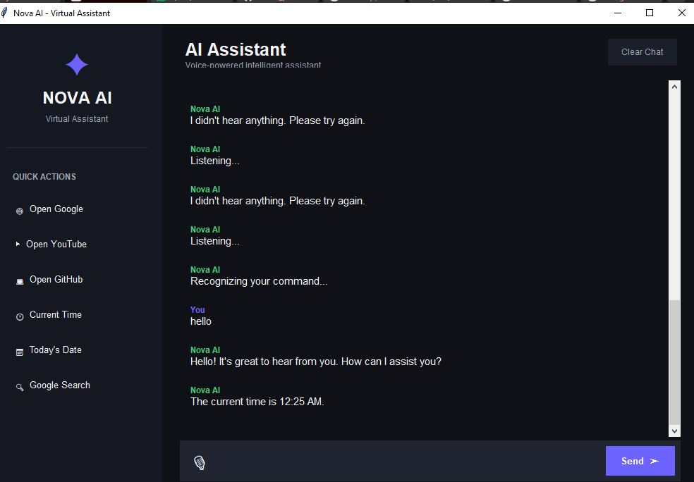

## 🖥️ Project Output

Here is the output of the Nova AI Virtual Assistant:


# 🤖 Nova AI – Virtual Assistant


## ⚙️ Installation

### 1. Clone the repository

```bash
git clone https://github.com/yourusername/Professional_AI_Assistant.git
```

### 2. Open the project folder

```bash
cd Professional_AI_Assistant
```

### 3. Install dependencies

```bash
pip install -r requirements.txt
```

Or install them manually:

```bash
pip install SpeechRecognition pyttsx3 PyAudio
```

---

## ▶️ Run the Application

Run the following command:

```bash
python assistant.py
```

The Nova AI desktop application will open.

---

## 🎙️ Example Commands

You can use either voice or text commands.

### 🌐 Website Commands

```text
Open Google
Open YouTube
Open GitHub
```

### 🔍 Search

```text
Search Python tutorials
Search machine learning
Search artificial intelligence
```

### 🕐 Time & Date

```text
Tell me the time
Tell me the date
What day is it
```

### 🧮 Calculator

```text
Calculate 25 * 4
Calculate 100 / 5
Calculate 50 + 25
```


## 🎯 Project Objective

The main objective of this project is to understand the fundamentals of **voice-based human-computer interaction** using Python.

It demonstrates how a computer can:

1. Capture a user's voice.
2. Convert speech into text.
3. Identify the user's command.
4. Perform an appropriate action.
5. Generate a response.
6. Convert the response into speech.

---


## 📌 Example Workflow

**User:**

```text
Open Google
```

**Nova AI:**

```text
Opening Google for you.
```

Google then opens automatically in the default browser.


